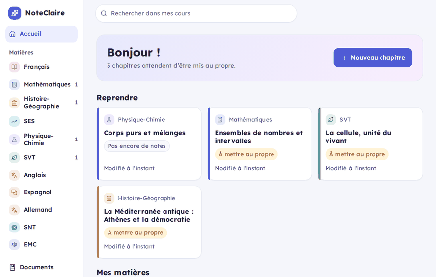
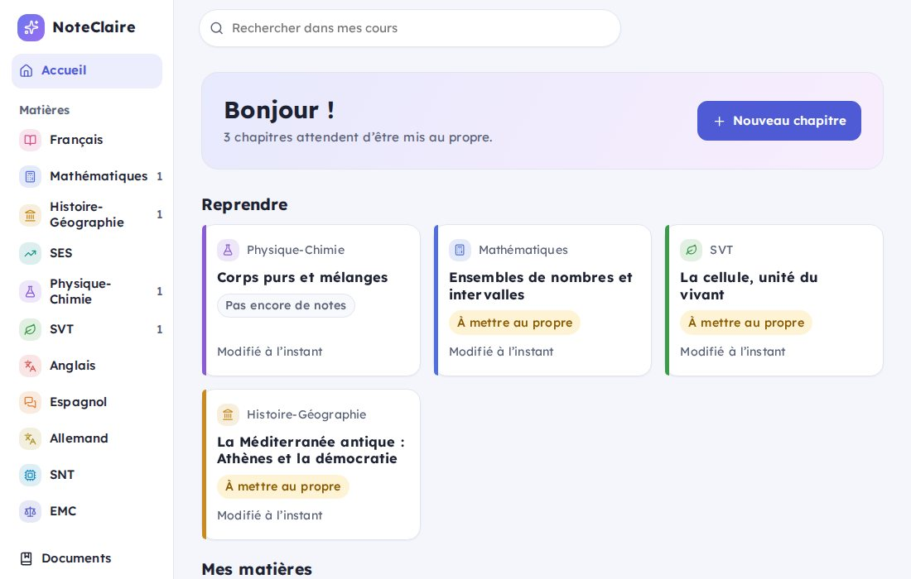
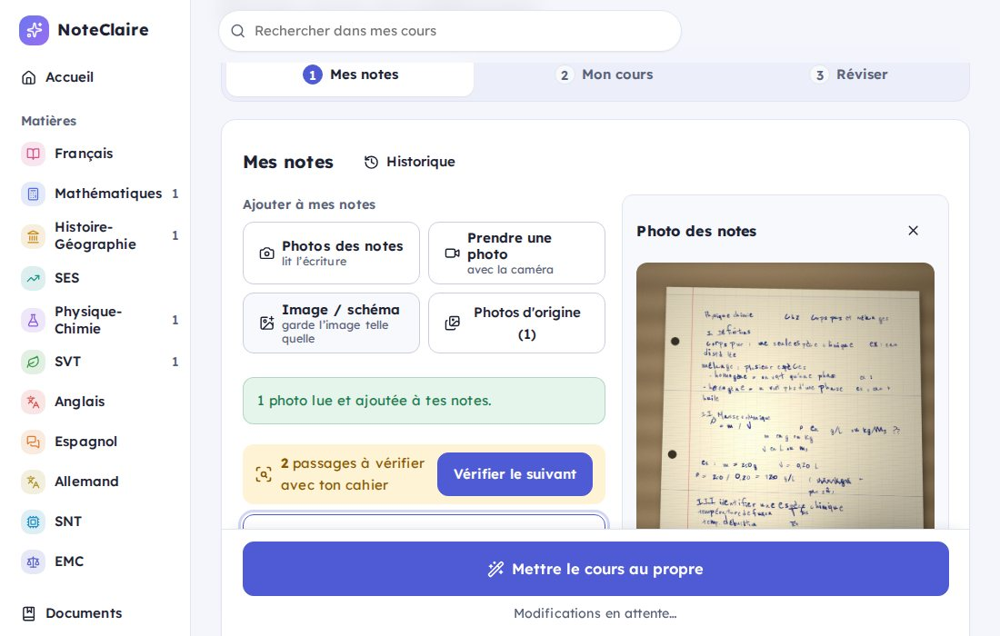
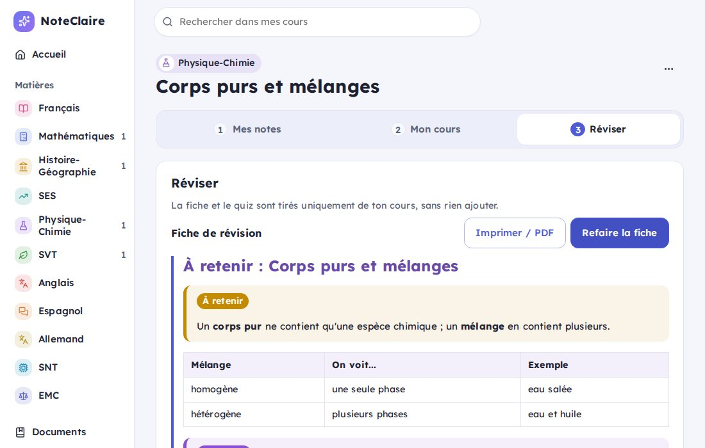
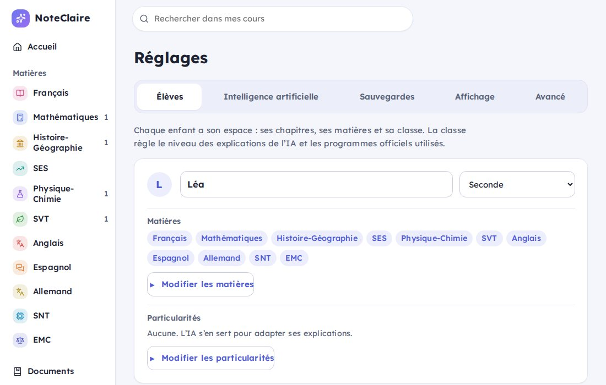
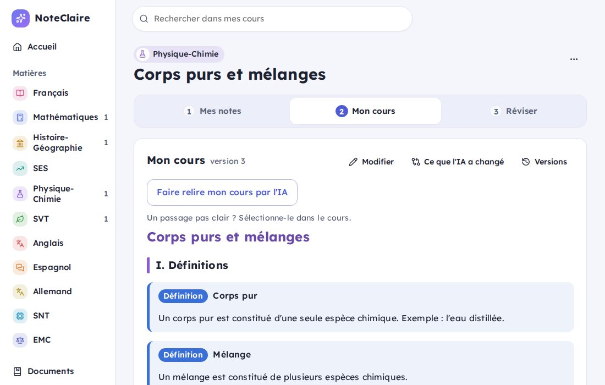

<div align="center">

# NoteClaire

**Remettre ses notes de cours au propre, avec une IA qui ne remplace jamais le travail de l'élève.**

[](https://github.com/jogit/noteclaire/actions/workflows/ci.yml)
[](LICENSE)

[Site du projet](https://jogit.github.io/noteclaire/) · Pour les lycéens (seconde, première, terminale ; voies générale et technologique) ·
un espace par enfant · pensé pour les élèves dys · auto-hébergé, vos données restent chez vous



</div>

## Principe

L'élève continue de prendre ses notes à la main en classe. À la maison, NoteClaire l'aide à :

1. **saisir ses notes ou les photographier** : l'IA recopie le texte sans rien corriger et signale
   les mots qu'elle n'a pas pu lire ;
2. **remettre le cours au propre** : orthographe, ponctuation et mise en forme, sans reformuler
   ni inventer ;
3. **relire** son cours : l'IA propose des corrections et des compléments en citant le programme
   officiel de sa classe, et c'est toujours l'élève qui accepte ou refuse ;
4. **réviser** : fiche de révision, quiz, export vers [Anki](https://apps.ankiweb.net).

L'IA ne remplace jamais silencieusement les notes de l'élève : les notes originales sont conservées
et chaque modification se voit.

## Fonctionnalités

| | |
| --- | --- |
| **Notes** | Saisie au clavier ou photos de cahier (plusieurs pages), schémas découpés et redessinables, mots douteux signalés, historique des versions |
| **Cours** | Mise au propre en Markdown (encadrés, formules, schémas), comparaison avec les notes, éditeur visuel, versions, export PDF et Markdown |
| **Relecture** | Suggestions une par une, appuyées sur les programmes officiels et leur source ; « Je n'ai pas compris » |
| **Révision** | Fiche de révision, quiz (QCM, vrai/faux, réponse courte), export Anki |
| **Famille** | Un espace par enfant (classe, matières, particularités), données séparées côté serveur |
| **Sécurité des données** | Corbeille de 30 jours, sauvegardes quotidiennes, restauration vérifiée |
| **IA au choix** | Clé OpenAI, abonnement ChatGPT, ou modèle local (Ollama, LM Studio) ; budget mensuel réglable |

### Aperçu

| | |
| --- | --- |
|  |  |
| **Accueil** : reprendre où l'on en était | **Mes notes** : la photo, le texte lu, les mots à vérifier |
|  |  |
| **Mon cours** : encadrés, formules, relecture | **Réviser** : fiche et quiz |
|  |  |
| **Un espace par enfant** | **Thème crème**, espacement aéré |

### Pensé pour les élèves dys

- Police Lexend (conçue pour la lisibilité), texte jamais justifié, ni en majuscules, ni en
  italique, lignes courtes.
- Grands boutons et grandes cases à cocher ; une seule action principale par étape.
- Thème **Crème**, espacement des lettres et des mots, taille du texte, thème sombre.
- Particularités de l'élève (dyslexie, dyspraxie, TDAH…) transmises à l'IA pour adapter ses
  explications et ses fiches.
- Contrastes et libellés contrôlés automatiquement dans chaque thème.

## Installation

Il faut seulement [Docker](https://docs.docker.com/get-docker/) (Docker Desktop sur Windows et Mac).
Le script télécharge la configuration, choisit un mot de passe (affiché à la fin), démarre
l'application et ouvre le navigateur. Il demande si l'IA doit utiliser un abonnement ChatGPT
(Plus ou Pro) ; sinon, la clé OpenAI ou l'IA locale se choisit dans l'application.

**Linux et Mac** :

```bash
curl -fsSL https://raw.githubusercontent.com/jogit/noteclaire/main/scripts/install.sh | sh
```

**Windows** (PowerShell, Docker Desktop lancé) :

```powershell
irm https://raw.githubusercontent.com/jogit/noteclaire/main/scripts/install.ps1 | iex
```

L'application est ensuite sur http://127.0.0.1:8080 (utilisez cette adresse, pas `localhost`, sur
l'ordinateur qui l'héberge) ; le mot de passe généré est rappelé à chaque lancement du script et
gardé dans `~/noteclaire/.env`. Au premier accès, un assistant demande le prénom et la classe de l'élève, puis le
choix de l'IA, qu'il teste (clé OpenAI, compte ChatGPT, IA locale, ou « Essayer sans IA »). Il propose
ensuite de télécharger les programmes officiels de la classe, pour que la relecture cite ses sources.

- **Mettre à jour** : relancer la même commande (le `.env` et les données sont conservés).
- **Arrêter** : `cd ~/noteclaire && docker compose down`.
- **Abonnement ChatGPT** : la connexion se fait une seule fois, depuis l'ordinateur qui héberge
  NoteClaire, à l'adresse `http://127.0.0.1:8080` (OpenAI n'accepte que celle-là). Ensuite tous les
  appareils de la maison utilisent l'IA. Voir [Configuration](docs/configuration.md#abonnement-chatgpt-sign-in-with-chatgpt).

<details>
<summary>Installation manuelle ou depuis les sources</summary>

Avec les images publiées : enregistrez `docker-compose.yml` à côté d'un `.env` (modèle :
`.env.example`), puis `docker compose up -d`.

Pour compiler les images vous-même :

```bash
cp .env.example .env
# Dans .env : APP_PASSWORD
docker compose up -d --build
```

Port 8080 occupé : `HTTP_PORT=8081` dans `.env`.

</details>

## Documentation

- [Guide d'utilisation](docs/guide.md) : photos et schémas, relecture, révision, plusieurs enfants,
  sauvegardes et restauration.
- [Configuration](docs/configuration.md) : choix de l'IA, programmes officiels, reverse proxy, variables.
- [Vie privée](docs/vie-privee.md) : ce qui reste chez vous, ce qui part vers l'IA, données sensibles.
- [Abonnement ChatGPT et conditions d'OpenAI](docs/openai.md) : ce que dit OpenAI, ce que NoteClaire respecte, ce qu'il reste à vérifier.
- [Dépannage](docs/troubleshooting.md) : erreurs Docker, mot de passe perdu, caméra, ChatGPT.
- [Cahier des charges](docs/SPEC.md) : périmètre, architecture, modèle de données.
- [Pistes pour la suite](ROADMAP.md) : ce qui est envisagé, sans engagement.

## Vie privée et sécurité

- Auto-hébergé : base SQLite et fichiers dans vos volumes Docker, rien ne part vers un service de
  NoteClaire. Seul le texte envoyé à l'IA que vous choisissez quitte la maison (jamais avec une IA locale).
- Les métadonnées des photos (dont la position GPS) sont retirées avant tout envoi à l'IA.
- Accès protégé par un mot de passe (obligatoire dès que d'autres appareils s'y connectent) ;
  les chapitres sont séparés par enfant, sans code par enfant (changer d'élève reste libre).
- Clés et jetons chiffrés au repos, jamais renvoyés au navigateur ni sauvegardés.

## Développement

Python 3.12 + [uv](https://docs.astral.sh/uv/), Node 22.

```bash
make install        # dépendances
make dev-backend    # API sur http://localhost:8000
make dev-frontend   # application sur http://localhost:5173
make check          # lint + types + tests (ce que la CI exécute)
make coverage       # couverture
```

Tests de bout en bout (Playwright) sur l'application lancée :
`cd frontend && npx playwright install chromium && npm run e2e`.

**Pile technique** : FastAPI, SQLAlchemy, SQLite (FTS5), Alembic · Vue 3, TypeScript, Vite, TipTap,
KaTeX, Mermaid. Les règles de développement sont dans [AGENT.md](AGENT.md).

## Licence

NoteClaire est publié sous [GNU AGPL-3.0](LICENSE) : libre pour les particuliers et les familles, qui
peuvent l'installer, le modifier et le partager. Quiconque le propose en service à d'autres
personnes doit publier ses modifications sous la même licence. Voir aussi [NOTICE](NOTICE),
[composants tiers](THIRD_PARTY_NOTICES.md), [SECURITY.md](SECURITY.md) (signaler une faille) et
[CONTRIBUTING.md](CONTRIBUTING.md).

NoteClaire ne contient aucun document officiel : les programmes de l'Éducation nationale sont
téléchargés, à votre demande, depuis les sites officiels (voir
[Configuration](docs/configuration.md#programmes-et-documents-de-référence)).
