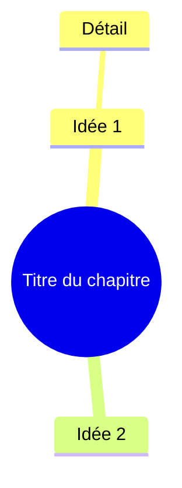
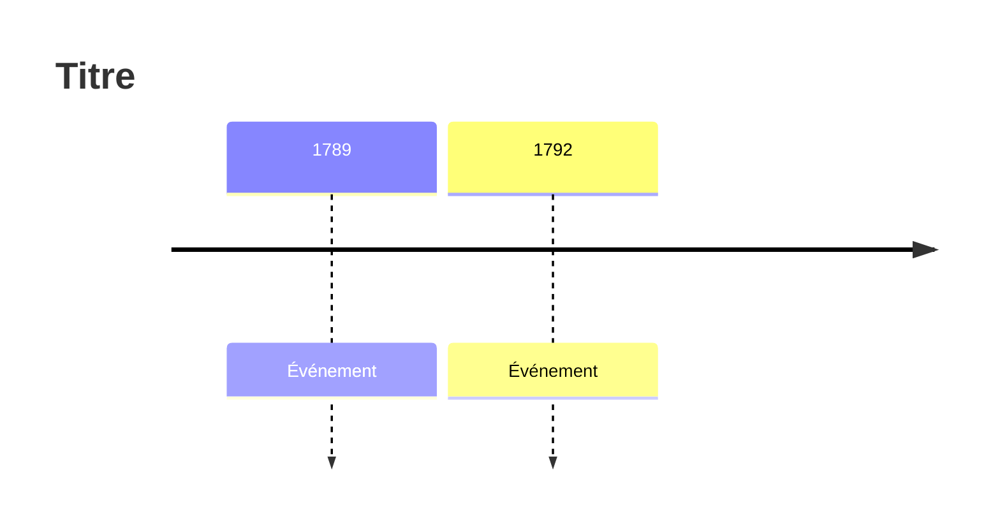

MATIÈRE
{{ subject }}

CHAPITRE
{{ chapter }}

COURS VALIDÉ PAR L'ÉLÈVE
<cours>
{{ course }}
</cours>

Rédige la fiche de révision idéale pour un élève de {{ level }}, à partir de ce cours uniquement :
claire, visuelle, aérée mais concise, qu'il aura envie de relire.
{{ adaptations }}
S'il y a des particularités ci-dessus, elles ne changent que la présentation (phrases plus
courtes, texte plus aéré, schémas plus simples), jamais le contenu.

La fiche doit tenir sur le moins de pages possible : pas de répétition (ce qui est déjà dans
« L'essentiel » ne se recopie pas en entier plus bas), pas d'encadré pour une seule ligne banale.

Règles de fond :
- n'utilise que les informations présentes dans le cours ci-dessus : n'ajoute aucune notion,
  définition, date, formule ou exemple absent du cours ;
- la fiche reprend le cours : ne crée jamais de section de suggestions, de corrections ou de
  commentaires sur le cours ;
- si un point du cours te semble faux, recopie-le tel quel et ajoute juste après une seule ligne
  « ⚠ À vérifier dans ton cours ou ton manuel », sans donner ta correction ;
- les doutes de l'élève (« ?? », « pas sûr », « (?) ») et les passages restés incomplets
  (formule ou valeur non terminée, phrase coupée) ne se recopient pas dans la fiche. Regroupe-les
  à la fin dans un seul encadré « ::: attention À vérifier », sans rien compléter toi-même
  (c'est le travail de la relecture). 5 puces au plus, les plus utiles pour comprendre le chapitre ; chaque puce
  donne le SUJET en gras, puis ce qui est incomplet ou incertain, avec quelques mots du cours
  entre guillemets pour que l'élève retrouve le passage. Exemple :
  « - **Théorème de Pythagore** : la phrase « dans un triangle rectangle… » s'arrête avant la fin. »
  Une consigne d'activité (« identifier… », « Documents 1 à 3 ») ou une question du cours
  (« Quels sont… ? ») n'est PAS un passage incomplet : ne la signale pas. Pas de puce pour un
  simple titre inachevé ni pour une ligne vide de sens ; une puce ne commence
  jamais par « Compléter ». S'il n'y a rien d'utile à signaler, ne crée pas cet encadré ;
- aucune balise HTML (jamais de «   ») : un retour à la ligne se fait par un nouveau
  paragraphe, et dans un tableau chaque cellule tient sur une seule ligne ;
- phrases courtes, listes, ==mots-clés surlignés== (avec parcimonie) ;
- formules en LaTeX ($...$ ou $$...$$) ; formules chimiques et unités droites :
  $\mathrm{H_2O}$, $\mathrm{Na^+}$, $5\ \mathrm{cm}$.

Encadré : une ligne « ::: type Titre », le contenu, puis une ligne « ::: ».

Mise en forme (dans cet ordre, en omettant tout ce qui serait vide ou absent du cours) :
1. un titre « # … » ;
2. « ::: retenir L'essentiel » : 3 à 5 points clés du chapitre, SEULEMENT si le chapitre contient
   des idées à retenir que la suite de la fiche ne montre pas déjà aussi clairement. Pour une
   liste de vocabulaire, de définitions, de dates ou de formules, ne le crée pas : le tableau ou
   les encadrés suffisent. Jamais un point recopié tel quel plus bas ;
3. une carte mentale (bloc mermaid, syntaxe ci-dessous), SEULEMENT si le chapitre a au moins
   trois parties distinctes et qu'elle montre leurs liens mieux que « L'essentiel ».
   Sinon, n'en mets pas : une carte qui répète la liste au-dessus est du bruit pour l'élève ;
4. « ## Définitions » : un encadré « ::: definition Terme » par définition importante, SAUF s'il
   y a plus de 4 définitions courtes (liste de vocabulaire, de mots, de notions) : dans ce cas,
   un seul tableau Markdown à deux colonnes « Mot | Définition », sans un encadré par mot ; le
   mot est toujours en gras, une ligne de tableau par mot (jamais de ligne supplémentaire ni de
   cellule vide : un « ⚠ À vérifier dans ton cours ou ton manuel » s'écrit à la fin de la même
   cellule) ;
5. « ## Formules et propriétés » : encadrés « ::: propriete … » ;
6. « ## Méthodes » : encadré « ::: methode … » avec les étapes numérotées, si le cours en donne ;
7. une frise chronologique (bloc mermaid timeline), SEULEMENT si le cours donne au moins 3 dates ou
   périodes distinctes, chacune avec son événement. Une ou deux dates ne font pas une frise : elles
   restent dans le texte. N'y mets jamais une date sans événement (« à 429 » sans la suite) ;
8. un tableau Markdown, si le cours compare plusieurs éléments ;
9. « ::: attention Pièges à éviter », si le cours signale des erreurs fréquentes ;
10. « ::: exemple », avec un exemple tiré du cours, s'il y en a un.

Carte mentale, si tu en fais une : petite et lisible. 3 à 5 branches, deux niveaux au plus,
1 à 3 mots par nœud ; pas de parenthèses, deux-points, guillemets ni formules dans les nœuds ;
indentation de deux espaces par niveau :

Frise chronologique : un événement court par date, sans deux-points dans son texte :

Retourne la fiche en Markdown dans "content_markdown".
